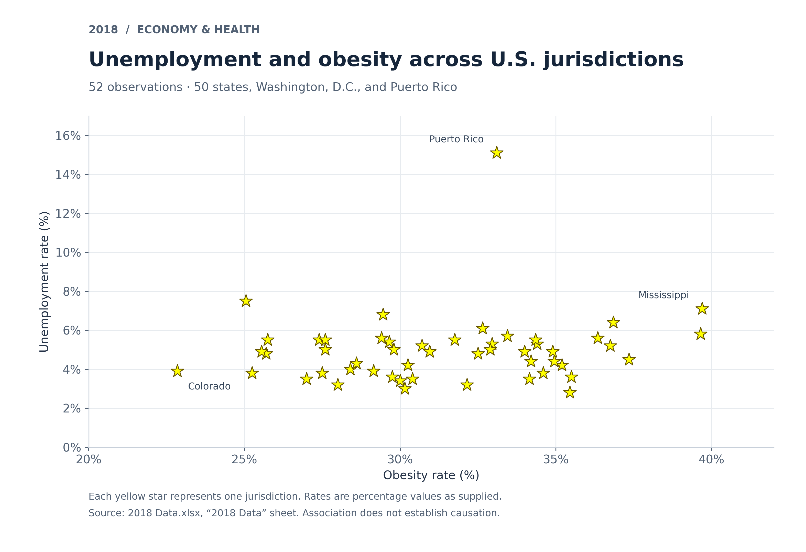
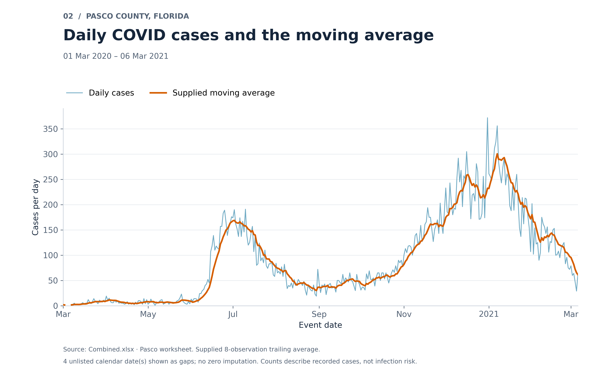
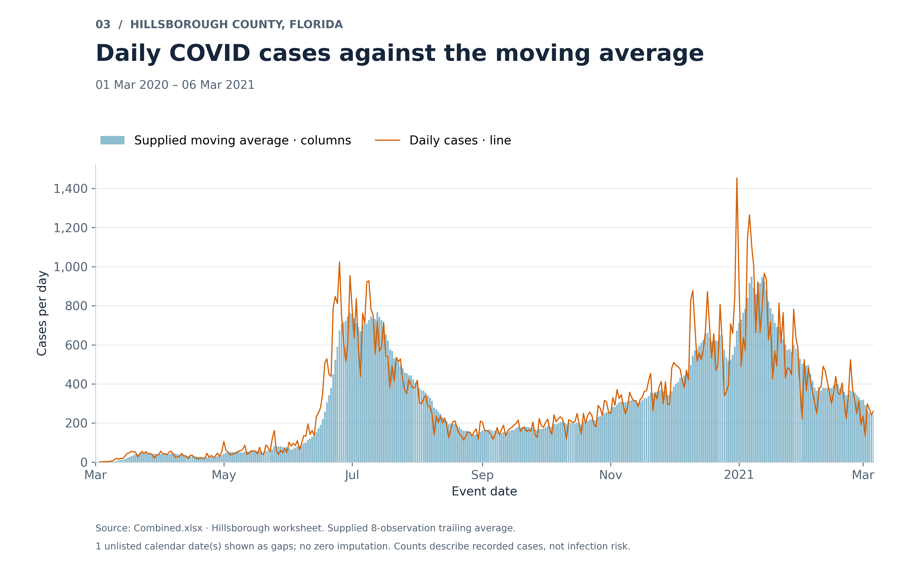
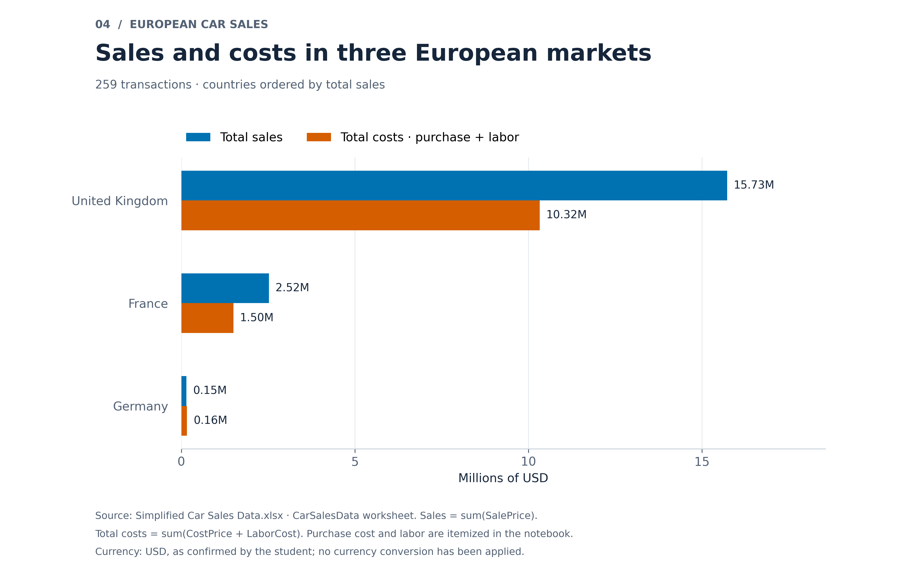
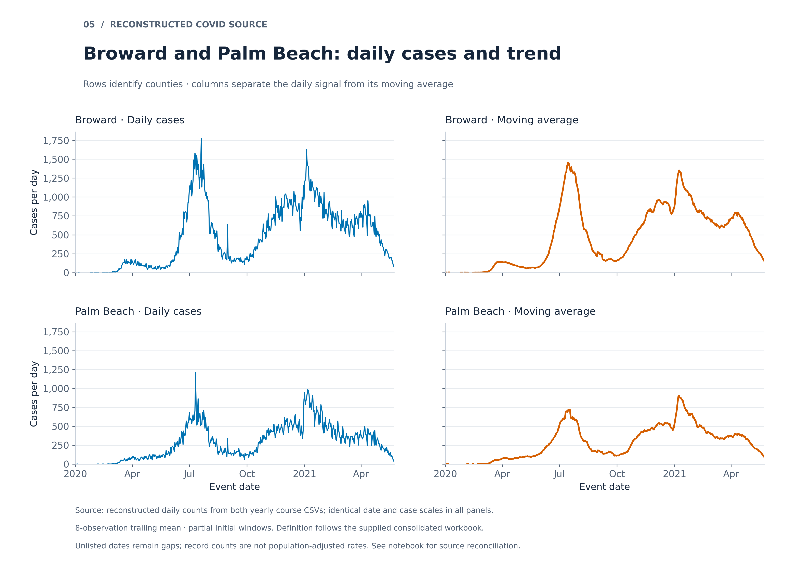

# Python data visualization assignment

Five Jupyter notebooks, matching Python scripts, and high-resolution figures using the supplied course data. Requirements **1–6 are implemented**. The Module 3 Tableau workbook and a verified Tableau Desktop connection are still needed for requirement 7; the Python calculation and local TabPy launcher are included.

| Notebook | Required output |
|---|---|
| [01 · Unemployment and obesity](notebooks/01_unemployment_obesity.ipynb) | Yellow-star scatter plot, 2018 |
| [02 · Pasco COVID](notebooks/02_pasco_covid.ipynb) | Daily cases and moving-average lines |
| [03 · Hillsborough COVID](notebooks/03_hillsborough_covid.ipynb) | Moving-average columns and daily-case line |
| [04 · European car sales](notebooks/04_european_car_sales.ipynb) | Horizontal sales/cost bars for UK, France, Germany |
| [05 · Reconstruct COVID and county panels](notebooks/05_reconstruct_covid_and_panels.ipynb) | Both yearly sources, then Broward/Palm Beach in a 2 × 2 figure |











## Run

Use Python 3.12. Create and activate a virtual environment, then:

```bash
python -m pip install -r requirements.txt
python -m ipykernel install --sys-prefix --name python3 --display-name "Python 3 (assignment)"
python tools/prepare_data.py
python tools/run_notebooks.py
python -m unittest discover -s tests -v
```

For interactive use, start `python -m jupyterlab`. See [the submission guide](SUBMISSION_GUIDE.md) for Windows activation, source definitions, and final packaging; see [Tableau steps](tableau/TABLEAU_STEPS.md) for requirement 7.

## Source and method notes

- All **2,279,873** case records are retained. The original yearly files are preserved losslessly in [data/2 yearly.zip](data/2%20yearly.zip). Each extracted CSV exceeds GitHub's 100 MB per-file limit; `tools/prepare_data.py` restores exact original sizes and SHA-256 hashes. No sampling or lossy compression is used.
- The consolidated workbook's averages reproduce an **8-observation trailing mean**, including the current observation and partial initial windows. Missing calendar dates are shown as gaps, and original workbook averages are preserved.
- The raw reconstruction and consolidated workbook differ; the notebooks report their comparison rather than modifying either source to force agreement.
- Sales are in **USD**, as confirmed by the student. Total costs include `CostPrice + LaborCost`; the notebook itemizes both.
- `vader_lexicon.txt` and the hotel-review dataset are unrelated and excluded.
- The original root-level `2018 Data.xlsx` from the user's earlier commit is retained; the identical canonical analysis input is under `data/`.

This repository is not yet a complete submission without the final Tableau `.twbx` and Desktop validation. The listed rubric totals 60 points; no grade is guaranteed.
